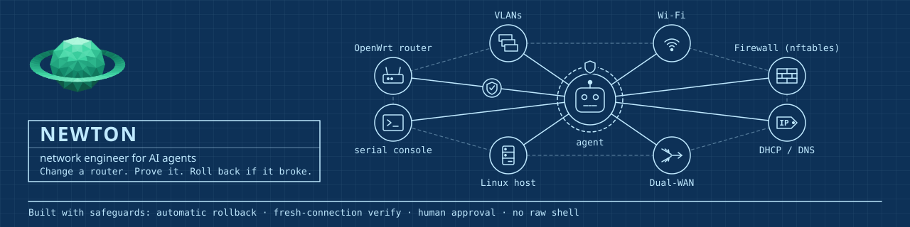

<p align="center">
  
</p>

# Newton

**Change a router. Prove it. Roll back if it broke.**

**Install:** paste this into Claude Code on the Linux machine that will manage your router ([Get started](#get-started) has the details):

```text
Install Newton from https://github.com/kevwillow/newton-senior-engineer and follow SETUP.md there.
```

Website: [gurutechnology.services/newton-engineer](https://gurutechnology.services/newton-engineer/), with the security boundaries, the roadmap, and how to help test Newton on network gear the lab does not have.

Newton lets an AI assistant like Claude Code set up and change your network for you: routers, VLANs, Wi-Fi, firewall
rules, port forwards, DHCP, DNS and dual-WAN. It is the safe way to let the AI do the work. On the default setup every change is shown to
you first and needs your approval, unless you gave a scoped grant or set the router to lab (see Approvals). It arms an undo timer on the router, so it undoes itself if something breaks, and it is only kept after a
fresh connection proves your network still works. In the no-install mode that timer lives in the router's RAM, so a
router that reboots in the middle of a change keeps the change.

Newton is an operational skill for an AI agent plus an MCP server (`newton-mcp`). Both speak the same change protocol, so
any MCP-capable agent can use it: Claude Code, Codex, OpenCode or any MCP client.

Newton has two modes. In the **installed** mode the changes run over SSH. In the **no-install** mode Newton puts
nothing on the router but one limited web-interface user, and the same protocol runs over the router's own web API.

The change protocol is the whole product. The agent proposes a `uci batch`; Newton stages it, shows the diff, applies it under a rollback timer (60 to 600 seconds, 90 by default), verifies over **new** SSH connections that management and the network still work, and confirms only after three consecutive passing rounds. If anything fails, the router reverts on its own. The rollback timer lives on the router, so it still fires if the agent's session dies. That is the **installed** mode.

In the **no-install** mode the writes go over HTTPS, pinned by the certificate the setup read over the admin lane. The
undo is OpenWrt's own rpcd timer (in the router's RAM, 120 to 600 seconds, 180 by default), and a change is
confirmed only when every mandatory check passes and the router's values read back as the staged ones.

Newton also works on Active Directory, on the main branch ahead of its release (see [Active Directory](#active-directory)
and [Status](#status)): a read-only audit of Windows Server AD and Samba AD domains with 48 checks, and a small set of
account changes. For every change but an unlock, which has nothing to put back, the domain controller arms its own
undo before it writes. You approve each AD change in your own terminal, and the domain controller checks that
approval itself. Newton prints the setup scripts; you run them on each domain controller.

## What Newton puts on your router

An OpenWrt router works in one of two modes. The no-install mode is the default for a new OpenWrt
router; the installed mode puts Newton's own program on the router. The owner picks the mode with
`sudo -u newton /usr/local/bin/newton-router-setup <device> no-install` or
`sudo -u newton /usr/local/bin/newton-router-setup <device> install`, and both
modes are shown side by side, in plain words, before the router is touched.

**no-install:** Newton puts nothing on the router except one web-interface user. Every change uses OpenWrt's own undo timer. Limit: if the router reboots or its web service restarts while a change waits for confirmation, the change stays. Limit: whoever steals Newton's router password could take an interface down, restart Wi-Fi, kick a device off, or store files in /etc/luci-uploads, without your approval. Newton applies only DHCP static leases and DNS entries itself; every other change is a script you approve and run.

**installed:** Newton puts a program on the router: a small set of shell scripts (6 files, about 216 KB), no packages and no compiled code. Newton's key can run that program and nothing else, so the agent never gets a root shell. If a Newton change is still waiting for confirmation at boot, the guard puts the last good settings back, so a reboot cannot leave that change stuck. More checks can run, and fewer changes need a script. uninstall removes Newton's program and key; it keeps the guard's saved settings and the rest of /etc/newton (its lock and log), the program directory, the WAN-health settings in /etc/config/newton_wanhealth, the keys from before swap-key and the sysupgrade file: the saved settings and the copy of your keys are what you restore by hand.

The uninstall takes out every Newton key line on the router, for every host and label, including the key the Newton
server itself uses; the next section lists what it removes and keeps, and how to put each key back.

The no-install mode is **not** as safe as the installed mode. Its rollback is OpenWrt's own, the
same one LuCI uses, and Newton only applies the changes that are acceptable if they stay. The
installed mode keeps a guard on the router's own flash, so a reboot cannot leave a change stuck.

### The installed mode, in detail

This is exactly what the installed mode puts on your router, and what protects you. The install
prints the same text on your terminal before it asks you to agree:

```text
What Newton puts on your router

Newton's executable code is a small set of POSIX shell scripts; it also writes the configuration and service entries listed below.
No package is installed and nothing is compiled: about 216 KB of shell in 6 files.

  /usr/libexec/newton/newton-router     148 KB  the program Newton talks to
  /usr/libexec/newton/newton-safe-apply   24 KB  the change helper
  /usr/libexec/newton-guard              31 KB  the rollback guard
  /etc/init.d/newton-guard               525 B  starts the guard at boot
  /usr/libexec/newton/newton-wan-health   11 KB  the dual-WAN health check
  /etc/init.d/newton-wan-health          641 B  starts the health check

It also writes the device name, the profile and the zones under /etc/newton
(and, once you pick an approval passphrase, the approval key), the WAN-health
settings in /etc/config/newton_wanhealth, the boot links
/etc/rc.d/S09newton-guard, /etc/rc.d/S95newton-wan-health and
/etc/rc.d/K10newton-wan-health, and
13 lines in /etc/sysupgrade.conf, so a firmware upgrade
keeps them. The guard service runs at boot; the WAN-health check stays idle
until you set newton_wanhealth.main.enabled=1. One more line goes into
/etc/dropbear/authorized_keys, but the install does not write it: swap-key
or add-key does.

Why: the rollback has to survive a reboot or a cut link, so it lives on the
router; and Newton's key may run Newton's program and nothing else.

What protects you:
  - on the default prod profile every change needs your approval, and Newton
    only reads until you give one;
  - a router you set to lab applies changes without asking, except the ones
    Newton always asks about. Among them: SSH (dropbear), the web interface
    (uhttpd), rpcd, a users or keys config, the management interface or zone,
    opening more to the WAN, and options that run commands or write files
    (22 rules in all, in the router program's leash). The inventory entry
    has to say lab = true as well, or every change still needs your
    approval;
  - the guard keeps the last good settings on the router's own flash, and if a
    Newton change is still waiting for confirmation at boot, it puts them back;
  - the agent never gets a root shell through Newton's restricted key: once
    swap-key or add-key has written it, that key can run Newton's program and
    nothing else. Until you run swap-key, every key already on the router
    stays as it is. The setup tool itself logs in as root with your password
    or your admin key, when you run it; the agent never gets that login.

The trade-off: your router runs Newton's code, so it has to be kept in step with
Newton: run 'sudo -u newton /usr/local/bin/newton-router-setup <device> upgrade'.
'sudo -u newton /usr/local/bin/newton-router-setup <device> uninstall' removes
the program, the guard, the boot links, the config files, EVERY Newton key line
on the router for every host and label (including the key the Newton server
itself uses), and the sysupgrade lines. The run prints each removed key with its
restore command; after a reinstall, restore each one, on the Newton host that holds that
key, with
'sudo -u newton /usr/local/bin/newton-router-setup <device> add-key <label> <role>'.
On purpose it keeps the guard's saved copies of your settings
(/etc/newton/lkg and /etc/newton/quarantine) and the rest of /etc/newton
(the guard's lock and log), /usr/libexec/newton, the WAN-health settings file
/etc/config/newton_wanhealth, the copy of your keys from before swap-key,
/etc/dropbear/authorized_keys.newton-prev, and the /etc/sysupgrade.conf file.
The Newton lines go out of that file; the file itself stays, empty when the
install created it. The copy of the keys holds the key line swap-key took
out; if you still want that key to log in, copy the line back first. To
remove those by hand:
  rm -rf /etc/newton /usr/libexec/newton /etc/config/newton_wanhealth /etc/dropbear/authorized_keys.newton-prev
and delete /etc/sysupgrade.conf once you have checked that none of your own
lines are left in it.
The run-time files in /tmp/newton and /tmp/owrt-safe-apply.lock are in memory and go at
the next reboot. The uninstall stops the WAN-health check first, and its
restore removes the WAN-health run-time state in /var/run/newton-wan-health
(every *.state file and all_down.flag); the directory itself stays, empty.
```

## Get started

Paste this into Claude Code on the Linux machine that will manage your router (for another MCP client, see
[`docs/SETUP-CLIENTS.md`](docs/SETUP-CLIENTS.md)):

```text
Install Newton from https://github.com/kevwillow/newton-senior-engineer and follow SETUP.md there.
```

The agent reads [`SETUP.md`](SETUP.md) and does the rest of the talking. It checks the prerequisites, shows you the
release and its 40-hex commit id to compare with GitHub, and hands you the install command to run with `sudo`
yourself. The install creates a separate `newton` account that holds the router keys. Adding your router takes a few
more commands that you also run yourself, with `sudo`, so your password never passes through the AI. You pick your
approval passphrase there. On a router in the installed mode you can also scan a QR code into an authenticator app
and approve with 6-digit codes instead; the setup offers the codes on installed-mode routers only. Last, the agent runs a
read-only checkup.

Prerequisites: Linux with `sudo`, `git`, an SSH client, Python 3 with `venv` (Debian/Ubuntu:
`sudo apt install python3-venv`) and Claude Code's `claude` command on your PATH. `qrencode` is optional: it shows
the authenticator QR code. Prefer to do it by hand? See [Manual install](docs/INSTALL.md).

Updating: every install after the first goes through `/usr/local/sbin/newton-bootstrap`, from a root shell:
`newton-bootstrap install <repo> <40-hex-commit-id>`. It checks the commit itself and asks you to type `install `
and the first 12 hex characters of the id. [Manual install](docs/INSTALL.md) has the steps.

[](LICENSE)
[](#supported-devices)
[](#status)

## What it looks like

```text
You:     Put my smart-home stuff on its own network so it can't see my laptops.

Newton:  I read router1. Today everything shares one network (192.168.1.0/24, 23 devices).
         Plan: a new IoT network on VLAN 20 (192.168.20.0/24) with its own Wi-Fi "Home-IoT",
         internet allowed, your main network blocked.
         What could break: devices you move will need to rejoin the new Wi-Fi.
         Undo: automatic in 180 s unless the checks pass (router1 runs the installed mode).
         Here is the exact change (14 lines) ... Shall I go ahead?

You:     yes

         ┌───────────────────────────────────────────────────────────────────┐
         │ NEWTON  APPROVAL  router1  plan 3f9c2a1e                          │
         │ WHAT THIS DOES                                                    │
         │ Adds network iot (VLAN 20), Wi-Fi "Home-IoT", zone iot → wan only │
         │ Enter your approval passphrase                         [Approve]  │
         └───────────────────────────────────────────────────────────────────┘

Newton:  NEWTON RESULT: CONFIRMED  router1  3f9c2a1e  IoT network on VLAN 20
         Checked from your registered test client: IoT gets an address and internet ✓,
         IoT cannot reach 192.168.1.20 (your NAS) ✓. Receipt saved.
```

## What you can ask

- "Check my router and tell me what to fix." (a read-only checkup on OpenWrt: listening services, installed packages, port forwards, UPnP, Wi-Fi settings, connected devices)
- "Draw my network." (the agent draws a diagram from what Newton read; see [Network maps](#network-maps))
- "Give the printer a fixed address." / "Forward port 25565 to my game server."
- "Set up a guest network that can only reach the internet."
- "Turn off UPnP and show me what is open to the internet."
- "Fail over to my backup internet when the main line drops."
- "Harden this router." (three levels: Standard, Hardened, Lockdown; [Hardening](#features) says what each one carries)
- "Undo yesterday's change." (installed mode)
- "Audit my Active Directory domain." / "Disable the account of the person who left." (on the main branch, see [Active Directory](#active-directory))

Questions like "why is the Wi-Fi slow?" stay read-only. Newton changes nothing outside a plan. On the default prod
profile you approve each plan, unless it falls inside a scoped grant you gave; a router you set to lab applies plans
without asking, except the changes Newton always asks about.

## Features

Everything Newton does, in one list.

- ✓ = in the current release, 1.1.3.
- ◆ = on the main branch, ahead of release, tested live on a lab domain.
- ◇ = on the main branch, ahead of release, covered by tests only.

A ✓ line says so when the feature works in one mode only, was run only in the virtual lab, or is covered by tests
with no recorded run on a real router.

**Changes that undo themselves**
- ✓ Plan → your approval (or your scoped grant; a lab router skips it) → apply → verify → keep, for every change. Nothing is written outside this flow. Before Newton contacts the router, you must have said yes in the chat and the agent must give an explanation whose steps match the change.
- ✓ Apply-with-automatic-rollback over rpcd, with the timer on the router. In the **installed** mode the change is confirmed only after three consecutive passing rounds; in the **no-install** mode it is confirmed only when every mandatory check passes and the router's values read back as the staged ones, and the undo is OpenWrt's own rpcd timer (in the router's RAM).
- ✓ The undo timer is armed **on the router** before anything changes. Installed mode: 60–600 s, 90 s by default. No-install mode: 120–600 s, 180 s by default. 120 s or more is advised for Wi-Fi.
- ✓ The undo puts back `/etc/config` only. Packages, passwords and files outside `/etc/config` are never rolled back.
- ✓ A reboot-safe guard (installed mode only): a router that reboots in the middle of a change comes back with the old config. It protects `/etc/config` entries only, and after a permanent failure (a boot loop, for example) it stops until you run `recover` at the console.
- ✓ Verification over **new** connections, never from the session that made the change. In the installed mode: three passing rounds in a row. In the no-install mode: every mandatory check passes and the values read back as staged.
- ✓ In both modes the router pings 1.1.1.1 and resolves openwrt.org before a change is confirmed (in the installed mode every round), so a router without internet access cannot confirm any change.
- ✓ In the installed mode every verify round also checks that services still run and haven't restarted since the previous round (the first round sets the baseline), and that fw4 accepts the firewall config. The no-install mode checks the internet, that the changed service runs, the AI's claims it can probe, and the read-back.
- ✓ In the installed mode, after a rollback, every `/etc/config` package is compared with its state before the change. Any difference is raised as an ALERT.
- ✓ In the installed mode the staged firewall config is checked with fw4 before you approve, and Newton refuses to start if the current firewall config is already broken. A staged change fw4 cannot judge is reported as "not checked", never as a pass.
- ✓ A plan is refused, and has to be made again, if the staged change or the router's config changed after the plan.
- ✓ Checks of the AI's claims: the AI writes down what should be true afterwards, as probes of 19 fixed types, and Newton checks them each round. In the installed mode a false claim triggers the undo. In the no-install mode a claim whose probe cannot run there, and every client claim, is listed as "not verified", and the change can still be confirmed. Covered by tests.
- ✓ Live checks for each hardening setting a change touches, so a setting the router silently ignores is never kept (installed mode).
- ✓ Checks from a client's point of view: DNS, DHCP and internet work, and anything meant to be blocked **is** blocked. They run from a client machine you register with `newton-vantage-setup`; a plan with a client check and no registered client for its zone is refused, and the window must be at least 150 s. A check that can't run is reported as "not tested", never as passed, and stops the confirm. Run in the virtual lab only, not on a real router. In the no-install mode client checks are listed as not verified.
- ✓ Undo after confirm ("undo yesterday's change"), as a new approved change, on installed OpenWrt routers only. If any later change or edit touched the same config, the whole undo is refused. It does not undo packages, passwords, reboots or client leases. Covered by tests; no lab scenario runs it.
- ✓ A backup before every change, in both modes. A backup tool (`newton_backup`, installed mode). A restore drill passed on the real router; it restores the lab runner's `sysupgrade -b` archive, because Newton has no restore tool.
- ✓ A receipt for every change: what changed, who approved it, what was checked, and how to undo it, plus a copy of the backup kept on the Newton host. A receipt that cannot be written never changes the result. Covered by tests.
- ✓ An audit log with the masked diff. Under the MCP server it records the operator as `mcp`; who approved a change is in its receipt.
- ✓ Around the apply and the rollback, Newton restarts the firewall when a change touches named nft objects, and restarts dnsmasq and checks DNS and DHCP when logd restarted.

**Approvals you control**
- ✓ An approval dialog in Claude Code, asking for your passphrase, or for an authenticator code (TOTP) on an installed-mode router.
- ✓ `newton-approve` in a terminal, as the fallback for any client without dialogs: you type `approve` and the first 8 characters of the plan id, then your passphrase.
- ✓ HIGH changes (management access, internet exposure, options that run commands) need a second typed confirmation, `<device> HIGH`, in the dialog every time. OpenWrt changes are either HIGH or not; there is no LOW/MEDIUM scale. The `newton-approve` terminal fallback does not ask the second question for router changes.
- ✓ A first-approval warning per device, shown in the dialog until your first approval on that device succeeds.
- ✓ Scoped grants: "allow these kinds of change on this router for the next 1, 4 or 8 hours". A grant covers four kinds of change only: DHCP reservations, DNS settings, the router's name, and the Wi-Fi name and password. It never covers a HIGH change, a change the leash always asks about, or an owner script. It ends early on any result other than CONFIRMED, or when you end it (`newton_grant_off` or `newton-enrol grant-off`); a result made inside a grant says so. Covered by tests.
- ✓ A loud result after every change: `NEWTON RESULT: CONFIRMED / ROLLED BACK / UNKNOWN / NOT APPLIED`.
- ✓ The dialog stops waiting after about three minutes (180 s) and tells you how to approve from a terminal.
- ✓ Three wrong approval answers lock approvals on that device for 5 minutes, doubling up to 24 hours. An answer given in under 1.5 s is rejected.
- ✓ A reminder to clear your screen after typing a passphrase.
- ✓ Approval tokens expire and are single-use; the Newton host enforces the single use. Each one is bound to the exact change and the router's current config, and an approval lasts at most 30 minutes. On an installed OpenWrt router the router program checks it again (its expiry and the length of its window); in the no-install mode and on VyOS, RouterOS and Junos only the Newton host checks it.
- ✓ The leash: changes to Newton's own access, the management network, internet exposure, or options that run commands always need approval. On an installed router it runs in the router program (22 rules); in the no-install mode it is the Newton host's policy only.
- ✓ A lab mode for test routers: a router applies changes without approval only when its inventory entry says `lab = true` and its profile is lab, and leash changes still ask. The code still marks this lab exception as provisional.

**Security**
- ✓ The router keys belong to a separate `newton` account. The AI's user can't read them, and `newton-doctor` checks this. The launchers run only as `newton`, in a clean environment. Only `newton-mcp` runs without your password, and it takes no arguments; every other launcher asks for your sudo password each time, and the installer checks its sudoers file with `visudo`. The separation holds only if the AI's user has no passwordless sudo or other root path of its own: `newton-doctor` reports that, but cannot fix it.
- ✓ An MCP server with seventeen tools (`newton_list_devices`, `newton_read`, `newton_backup`, `newton_plan_change`, `newton_plan_undo`, `newton_apply_change`, `newton_change_status`, `newton_abort_change`, `newton_grant_off`, `newton_list_tiers`, `newton_plan_tier`, `newton_guided_recommend`, `newton_guided_audit`, `newton_plan_scan`, `newton_run_scan`, `newton_list_getters` and `newton_get_state`) and no tool that runs arbitrary commands, reboots, upgrades or installs packages. `newton_list_getters` and `newton_get_state` are experimental read-only reads of non-OpenWrt devices by fixed getter id (never command text). The main branch adds six more, the `newton_ad_*` tools for Active Directory (see [Active Directory](#active-directory)).
- ✓ No Newton tool can run a shell command. Reads go through a fixed list, and the router program has a closed grammar of 25 subcommands, so a factory reset, a raw flash write, a bootloader change or a firewall flush cannot be expressed. The "never" and "ask first" lists in `SKILL.md` are instructions to the agent; the serial console script is the only Newton code with a command blocklist.
- ✓ Wi-Fi keys and passwords in fields and values masked before they reach the AI. A secret written out as prose is not detected.
- ✓ Device text (hostnames, Wi-Fi names, logs, scan results) marked as untrusted data, with prompt-injection tests. The marking tells the model the text is data; the model is still trusted to treat it that way.
- ✓ A small on-router program with a closed command grammar that refuses anything not in it.
- ✓ A verified install: the first install asks you to type the full 40-hex commit id of the release, and stops if it does not match. Updates through `newton-bootstrap` check the commit themselves and ask for the first 12 hex characters of the id.
- ✓ An optional question about Claude Code's managed settings (`allowManagedHooksOnly`): the default is no, and only the exact answer `lock` sets it, so only hooks from the system settings run and no agent hook can answer the approval dialog for you. An existing settings file is never overwritten. Covered by tests.

**Easy to use**
- ✓ One-line setup: paste the repo link into your coding agent, which follows `SETUP.md`. No end-to-end run of this through Claude Code is recorded yet; the installer of v0.5.0 was run live on a fresh Ubuntu virtual machine (2026-10-18).
- ✓ Network-engineer mode. Ask in plain words and Newton reads the router first, explains what it will change and what could break, and does one change at a time. Typing `/newton` or `/network-engineer` also starts it.
- ✓ Consequences first: "guests get internet and can't reach your NAS", with the config lines underneath.
- ✓ A smaller option offered next to a risky request, such as VPN-only access instead of a public port forward.
- ✓ Questions stay read-only. "Why is the Wi-Fi slow?" never changes anything.
- ✓ Setup helpers: `newton-router-setup` (check, install, no-install, offer-installed, approval-key, swap-key, add-key, revoke, profile lab or prod, upgrade, rollback, uninstall, lab-snapshot, owner-run, owner-finish), `newton-enrol` (totp, level passphrase or totp, rotate, grant-off), `newton-vantage-setup` (sets up the client machine for client checks and scans), `newton-doctor`, and `newton-bootstrap` for updates.
- ✓ A no-install mode for OpenWrt (`newton-router-setup DEVICE no-install`): nothing of Newton on the router but one limited web-interface user. Newton applies DHCP reservations and DNS entries itself under OpenWrt's own undo timer; every other change comes to you as a script you approve and run. Changes that could lock you out of management access or through the firewall are refused at plan time. It offers six tools (list devices, read, plan, apply, status, abort): no backup tool, undo after confirm, hardening levels, scans or guided audit. It cannot read the rpcd, uhttpd or dropbear config, files, cron, keys, passwords or packages, and every no-install plan says so.
- ✓ `scripts/newton-rules` (`add`, `remove`, `list`) for the network rules file. Planning does not read the file yet, so a rule changes nothing in this release.

**Hardening**
- ✓ Three levels, Standard, Hardened and Lockdown, from a catalogue of 47 controls covering management access, firewall, zones, DNS, DHCP, NTP, Wi-Fi, services, updates, logging and IPv6. On a real router `newton_plan_tier` carries 10 controls in one batch for Standard, and 17 controls in two batches for Hardened and for Lockdown; Lockdown differs from Hardened in one line (dropbear `DirectInterface` instead of `Interface`). Controls that depend on the lab or on the router's own setup are skipped: OW-MGMT-02, OW-FW-06, OW-NTP-01, OW-ZONE-02, OW-DNS-06, OW-DHCP-01, OW-LOG-01, OW-DNS-07 and OW-DNS-08. No level applies a Wi-Fi control yet. The opt-in controls (guest network, DNSSEC, DoH, IPv6 off, SSH key-only, UPnP on) are not reachable through the levels. Of the 47 controls, 7 have no change written yet and 8 are audit-only.
- ✓ Each level applied in ordered batches, with a reboot-survival test and an undo test, run on the real router for the controls the levels carry (installed mode).

**Checkup and scans**
- ✓ A guided interview (fourteen plain questions) that maps your answers to a hardening level and extras. It does not contact the router, and your answers are not an approval. Covered by tests.
- ✓ A read-only audit on OpenWrt: listening services, installed packages, port forwards, UPnP, Wi-Fi settings, connected devices. Newton has no read of running services yet. Several of these reads are refused on a no-install router, and the audit is refused on other platforms. Covered by tests; no live run is recorded.
- ✓ Recommendations, each naming a control, why it matters, what it could break, and whether a plan is ready for it, it is audit-only, or it is a gap. They do not carry the change lines and are not joined to the audit yet; plan a level or a change to see the exact lines. Suggestions for other platforms are marked UNVERIFIED.
- ✓ nmap scans from inside your network and from outside it, only after you consent each time. They need a client machine set up with `newton-vantage-setup`. IPv4 and TCP only. An inside scan covers one non-WAN subnet of at most /24, an outside scan the WAN address only. Profiles: quick (top 100 ports) and full-tcp (the router's address only, 300 packets per second). Consent is single-use and lasts at most 30 minutes. Covered by tests; no scan of a real router is recorded.
- ✓ A Wi-Fi scan with the router's own radio (channel crowding, look-alike networks), with consent. Installed mode with router program 1.2.0 or later; one scan per radio per 60 s; only channel counts and look-alike names are kept, never a BSSID. The roadmap records it as proven on the real router (the Asus RT-AX57M) on 2026-10-24 with router program 1.2.0; the log of that run is not kept in this repository.
- ✓ A runguide for a speed, latency, bufferbloat and Wi-Fi performance test that changes nothing on the router ([`references/network-diagnostic.md`](references/network-diagnostic.md)). It is instructions for the agent, not a tool, and has no tests. Its router step still uses a direct SSH login, which an agent under Newton does not have: those reads go through `newton_read`.

**Everyday changes, each a tested scenario**
- ✓ Fixed addresses (DHCP reservations), port forwards (add, change, remove), local DNS records, DNS upstreams, firewall allow and block rules, VLANs and zones, Wi-Fi settings, diagnostics. Each one passed as a scenario on the real router. Each change is the agent's own `uci batch`; there is no separate tool per kind of change. The guest and IoT zone scenarios ran on a wired VLAN; a guest Wi-Fi tied to its own zone has not been run as one scenario.
- ✓ Wi-Fi proven on a real radio (the Asus RT-AX57M): WPA3 with management-frame protection, WPA2/WPA3 mixed, hidden networks, client isolation. WPS is off on that router only because its Wi-Fi build has no WPS; a WPS on/off control is not built.
- ✓ Dual-WAN failover and failback, run by a health check on the router (failover measured at 13 s, failback at 3 s in one lab run; the log of that run is not kept in this repository), including a second WAN on a VLAN. Run in the virtual lab and on the Asus, the only real hardware it has run on. It uses netifd route metrics and Newton's health script, not mwan3.

**Network maps**
- ✓ "Draw my network": physical, VLAN, and firewall-zone diagrams the agent draws from what Newton read, following the skill's instructions. There is no map tool and no test: the rules to draw only what was read and to mark anything guessed "inferred" are instructions to the agent that no code checks. Some of the reads it uses are refused on a no-install router. A map tool is planned for 1.2.

**Other platforms**
- ✓ **Experimental:** changes with undo on VyOS (`commit-confirm`, reload mode), Juniper Junos (`commit confirmed`) and MikroTik RouterOS. RouterOS has no native undo Newton uses: Newton schedules a restore of a binary backup, so the undo is a reboot that interrupts traffic. Writes are limited to 17 allow-listed menus on RouterOS (on `/ip/dns` only the servers and the cache size), to allow-listed hierarchies on Junos, and by a list of refused paths on VyOS (system login, config management, and the telnet, HTTP, HTTPS, SSH, SNMP, TFTP and FTP services). These platforms get backup, plan, apply, status and abort only: no hardening levels, audit, scans, client checks, grants or undo after confirm. Tested only on virtual images in the lab, never on real hardware.
- ✓ **Highly experimental:** read-only reads of RouterOS (9 reads), VyOS (7), Junos (3: version, interfaces, routes), Arista EOS (3) and Cisco IOS XE (3). None has run on a real device: RouterOS, VyOS and Junos ran on lab virtual machines, and the EOS and IOS XE reads have never run anywhere. They never change anything. The running config read is disabled everywhere. FortiOS has a profile but no read enabled yet.
- ✓ **Experimental:** a serial console script for recovery when SSH is gone (probe, login, run, push; refuses the bootloader). It is a script, not an MCP tool: it has no undo timer and no owner approval, and its rules for commands like `uci commit`, `reboot` and `passwd` pass on an `--approved` flag the agent sets itself. Covered by unit tests and an OpenWrt console scenario on a virtual machine's serial socket; not tested on a physical console cable or a router UART. `SKILL.md` notes a first-boot serial bootstrap of RouterOS and VyOS in the virtual lab (2026-10-03); no log of that run is kept in this repository.
- ✓ **Experimental:** a Linux host timed-undo recipe in the skill, verified on ifupdown2, netplan and NetworkManager. Full Linux support is planned for 1.6.

**Proven, not claimed**
- ✓ A virtual lab: a virtual OpenWrt router, a virtual ISP with two upstreams and test clients, reset to a snapshot for every scenario.
- ✓ 96 scenarios in [`lab/scenarios`](lab/scenarios) for the virtual router, and a separate real-router suite in [`lab/scenarios-pulsar`](lab/scenarios-pulsar) (Wi-Fi included, through a USB adapter on the test client); its README lists which scenarios are ported. Its full run passed 97 of 97 scenarios on the Asus RT-AX57M (2026-10-23).
- ✓ A lab isolation check: lab routers never leak DHCP or router adverts onto your home network.
- ✓ A support table generated from test results, with each device's undo method and what is untested.
- ✓ Works with Claude Code, Codex, OpenCode, Claude Desktop and any MCP client.
- ✓ On-demand reference docs for OpenWrt, nftables and networking concepts.

### Active Directory

On the main branch, ahead of release, through six more MCP tools: `newton_ad_list_checks`, `newton_ad_audit`,
`newton_ad_plan_change`, `newton_ad_apply_change`, `newton_ad_change_status` and `newton_ad_abort_change`.
◆ = tested live on a lab domain; ◇ = covered by tests only.

The live runs (2026-11-12) used the code from before the last changes: since then the Windows write helper re-reads
and undoes at once a write that failed for a reason other than a conflict, every plan lists the domain controllers it
reads, and the undo outcome is reported back in more detail. Those changes are covered by tests only. The Samba write
helper is the one that ran live. The ◆ items below refer to those runs; the log of those runs is not kept in this
repository.

- ◇ A read-only audit of Windows Server AD and Samba AD domains: 48 checks (`newton_ad_list_checks`, `newton_ad_audit`) covering privileged groups, Kerberos and password policy, risky account flags, delegation, LDAP signing, channel binding and NTLM, stale accounts, ACLs, credentials left in SYSVOL, and backup keys. Every check runs on both kinds of domain. A check whose read failed is UNKNOWN, never PASS. The checks are tested against collector output measured on lab domain controllers; the audit tool was not part of the latest live runs.
- ◇ How the audit reads: a key-only SSH login of an ordinary `newton-audit` account that can run one fixed command (`collector.ps1` on Windows, `newton-ad-samba` through sudoers on Samba). The collectors never return password hashes, LAPS or BitLocker secrets, gMSA passwords, KDS root keys, trust secrets, backup-key values or key credentials, and never return a SYSVOL `cpassword` value. Newton refuses a document from the wrong collector, from a collector whose query set is out of date, or from an audit login that turns out to be privileged. An earlier version of the collectors ran on lab domain controllers; the Windows collector's SYSVOL read has changed since and has not run live.
- ◆ Setup scripts that Newton prints and you run as a Domain Admin: `scripts/newton-ad-setup windows|samba` for the audit, and `scripts/newton-ad-setup write windows|samba` for changes. The write setup creates the `newton-ops` account, which is never in a privileged group (the setup refuses one that is), and delegates on the PDC emulator only the rights the changes below need. It derives your approval key on the domain controller from the passphrase you type there. The Windows write setup also adds the "log on as a batch job" right to the Default Domain Controllers Policy, after a `Backup-GPO`, and edits `sshd_config`; run it over a password login, not a key login. A second domain controller is set up with `--domain-device` naming the first, so both hold the same approval key. The four write setups (two DCs of each kind) ran live; the audit setups are not part of those runs.
- ◆ Disable and enable an account. A privileged account is never disabled, and neither is the built-in Administrator. Live for a user account on two-DC Windows Server 2025 and Samba 4.22 domains; computer accounts are covered by tests only.
- ◆ Set the machine account quota (`ms-DS-MachineAccountQuota`, 0 to 1000) on the domain head, found by the `ad_domain_guid` in the inventory. Live on both kinds of domain.
- ◆ Unlock a locked-out account. An unlock has nothing to put back, so no undo is armed: the change is confirmed as soon as it is written on the PDC emulator. Privileged accounts can be unlocked too (covered by tests; the live target was an ordinary user). A Windows domain controller needs a write helper with the unlock fix (re-run the write setup); an older helper reports a conflict after a good unlock. Live on both kinds of domain.
- ◇ Clear account flags, set Kerberos encryption types (DES is never turned on), add or remove a member of a non-privileged group, create a user (created disabled, with a generated password shown once when you approve), and move an object between OUs. Covered by tests on the current code; an earlier version of the domain-controller helpers ran these in the lab, but not through Newton's plan and apply.
- ◆ The undo is armed on the domain controller before it writes (a `systemd-run` timer on Samba, a scheduled task on Windows). A withheld confirm rolled back on both domain controllers of both domains. Newton records a confirm the domain controller refused as a conflict. If the connection to a domain controller fails mid-apply, Newton still writes the receipt, and the result says which step was lost and tells you to run `newton_ad_change_status`; a change that is not confirmed is put back by the domain controller itself at its `undo_at`, except an unlock, which has no undo and stays written. A connection lost while a domain controller is read back counts as that domain controller not showing the change, so the change is aborted (covered by tests). The domain controller accepts an approval from one minute before its start time to its expiry, so its clock must track the Newton host's.
- ◆ A change that names another device is refused by every domain controller.
- ◆ Two or more domain controllers: a plan reads every domain controller that has a write entry in the inventory, and a change is confirmed only when every one of them shows it; otherwise it is aborted. An inventory with only a second domain controller is refused. Newton does not list the domain controllers of the directory itself, so one without a write entry is never checked; every plan lists the domain controllers it reads and warns about this (covered by tests). Writes go to the PDC emulator only: if the PDC role moves to a domain controller without a write entry, every change is refused until the inventory follows. A move of the PDC role was not tested live.
- ◆ Approval in your own terminal: `sudo -u newton /usr/local/bin/newton-ad-setup approval-key <device>` records your approval key's fingerprint, and `sudo -u newton /usr/local/bin/newton-approve ad-change <plan_id>` approves one change. It rebuilds the change from the plan itself, asks you to type `approve` and the first 8 characters of the plan id, then your passphrase, and gives a token valid for 30 minutes that the domain controller checks before it arms its undo. The Newton host keeps only the fingerprint, never the key; someone holding the fingerprint could still guess the passphrase offline, at the cost of 600,000 PBKDF2 rounds per guess. Passphrase only: no dialog and no authenticator code, and a HIGH AD change shows a warning but asks no second typed question. The approval logic ran live against real domain controllers from a source tree; the installed launchers have not been run live yet.
- Newton does not change privileged groups, delete objects, reset passwords, reset krbtgt, or change trusts, functional levels or Group Policy. The write account and krbtgt are never a target or a member. Privileged accounts can be targeted only by the flag, encryption-type and unlock changes.

## How a change works

```text
 PLAN               APPROVE              APPLY                VERIFY               KEEP
 ────               ───────              ─────                ──────               ────
 read the router    you see the diff     the undo timer is    new connections      saved, with a
 back it up         in plain words,      armed ON THE ROUTER  check management,    receipt and an
 stage the change   say yes, then        before anything      services, and your   off-device backup
 check the staged   approve in the       changes              client-side checks
 firewall config    Newton dialog
                                         any failed check, or no answer in time → the router undoes it by itself
```

The undo timer lives on the router, so it still fires if the AI, your laptop or the connection dies mid-change. A
reboot inside the window comes back with the old config too.

That is the **installed** mode. In the **no-install** mode the changes do not go over SSH: they go over the router's own
web API, over HTTPS pinned by the certificate, the undo is OpenWrt's own rpcd timer (which lives in the router's RAM),
and a change is confirmed only when every mandatory check passes and the router's values read back as the staged ones.

The wrapper takes **probe lists**, not a free-form shell check: lists of 19 fixed types, sealed on the router at plan time. A manifest id is expanded by the host into probe lists before staging, so the router never sees an id. Newton cannot hold the confirm for a test only you can run: after three passing rounds it confirms. If the affected path cannot be tested from the router, the agent host or a registered client, test it yourself from a client during the window and use `abort` before the third passing round.

### Approvals

- On the default prod profile every change needs **your** approval, or a scoped grant you gave. A router you set to lab
  applies changes without asking, except the ones Newton always asks about. The AI cannot approve for you: the dialog
  asks for your passphrase or an authenticator code, which the model is not given. A passphrase does pass through the
  Claude Code process, can reach its debug log, and an installed hook could read it; an authenticator code (offered by the setup in the installed mode only) keeps the reusable passphrase out of them, but the dialog is not confidential and a code that is still valid could be used by whoever sees it.
  See Known limits in [`SECURITY.md`](SECURITY.md).
- HIGH changes (management access, anything exposed to the internet, options that run commands) need a second typed
  confirmation in the dialog every time. The `newton-approve` terminal fallback does not ask it for router changes.
- **Scoped grants** make routine work quick: "allow DHCP reservations and DNS changes on router1 for the next 4
  hours". A grant lasts 1, 4 or 8 hours. Inside a grant you just see the diff and the result; anything outside it gets
  the full dialog.
- No dialog in your client, or you walked away? After about three minutes (180 s) Newton stops waiting and tells you how to
  approve from your terminal with `newton-approve`.
- Three wrong answers lock approvals on that device for 5 minutes, doubling each time up to 24 hours.
- Active Directory changes (on the main branch) are approved only in a terminal, with
  `sudo -u newton /usr/local/bin/newton-approve ad-change <plan_id>` and your passphrase; see [Active Directory](#active-directory).

## What it will never do

- Write router config through its MCP tools without the undo timer armed first. (The experimental serial console script has no undo timer.)
- **Never confirm a change from the session that applied it.** In the **installed** mode, verification runs over new SSH connections with connection sharing disabled. In the **no-install** mode it runs over the router's own web API, over HTTPS pinned by the certificate, and the change is confirmed only when every mandatory check passes and the router's values read back as the staged ones.
- Give the AI your router credentials. They belong to the separate `newton` account.
- Let the AI approve its own plan, or loosen its own limits.
- Run factory resets, raw flash writes, bootloader changes or a firewall flush. No Newton tool can express them.
- Treat text from your devices (hostnames, Wi-Fi names, logs) as instructions. It is marked as untrusted data.
- Show your Wi-Fi keys or passwords to the AI. Keys and passwords in fields and values are masked; a secret written out
  as prose is not detected.
- On Active Directory (on the main branch): change privileged groups, delete objects, reset passwords or krbtgt, or
  change trusts, functional levels or Group Policy.

## Supported devices

"Tested" means the seven scenarios of the support table pass: a normal change, a management lockout that undoes
itself, a firewall lockout that undoes itself, an injection attempt rejected, bad syntax rejected, a service still
reachable after the change, and an uplink failure that undoes itself. In the no-install mode the two lockout changes are
refused at plan time, so nothing is applied or undone for them. On VyOS, RouterOS and Junos the service change is refused
at plan time (Newton does not open a new service on them in this release), bad syntax is refused at plan time on VyOS but
applied and then undone on RouterOS and Junos, and an eighth scenario checks that an unapproved change is refused.

| Platform | Tested on | Undo method | Full features |
|---|---|---|---|
| OpenWrt 25.12 | a real Asus RT-AX57M (25.12.5) and a virtual router | timer on the router + reboot-safe guard | changes, hardening levels, undo after confirm, backups; the checkup and nmap scans are covered by tests with no recorded run on this router, and the Wi-Fi scan ran on it once (2026-10-24); maps are drawn by the agent |
| OpenWrt 25.12, no-install mode | the real Asus RT-AX57M (25.12.5) | OpenWrt's own `uci apply` rollback timer (no reboot-safe guard) | DHCP reservations and DNS entries; other changes as owner scripts |
| VyOS (rolling), experimental | virtual image, in the lab | `commit-confirm`, reload mode | changes |
| MikroTik RouterOS 7, experimental | CHR virtual image, in the lab | scheduled restore (undo is a reboot) | changes |
| Juniper Junos, experimental | vJunos virtual image, in the lab | `commit confirmed` | changes |
| Windows Server 2025 AD, on main | a two-DC lab domain | undo task on the domain controller | disable, enable, unlock, machine account quota; the audit is covered by tests |
| Samba AD 4.22, on main | a two-DC lab domain | undo timer on the domain controller | disable, enable, unlock, machine account quota; the audit is covered by tests |

OpenWrt 25.12.6 changed where rpcd keeps its sessions; 1.1.3 fixes Newton for it, and that fix was tested end
to end on a GL.iNet GL-MT3000 running vanilla OpenWrt 25.12.6 (the log of that run is not kept in this repository). The full 97-scenario hardware run predates router
program 1.3.1 and OpenWrt 25.12.6, and the support table does not list the GL-MT3000 run yet.

OpenWrt is the supported platform. The other three router platforms are experimental: they pass their scenarios
on virtual images only, so try them on a device you can reach by console before you trust them on one you can't. The
AD rows are on the main branch, ahead of release; [Active Directory](#active-directory) lists which changes ran live.

The full table, with versions and what is not tested, is generated from the test results:
[`docs/SUPPORT.md`](docs/SUPPORT.md). Linux hosts and more vendors are planned ([roadmap](docs/ROADMAP.md)).

## Network maps

Ask "draw my network" and the agent maps what Newton can actually read: WAN links, VLANs and switch ports, Wi-Fi
networks, firewall zones, and anything open to the internet. The skill tells the agent to draw only what was read
from your router, and to draw anything guessed dashed and labelled "inferred"; no code checks the drawing.
[See an example map](docs/assets/network-map-example.png).

## For reviewers and testers

You don't need real hardware to try Newton. The `lab/` directory builds a virtual OpenWrt router, a virtual ISP with two
upstreams and a test client on Proxmox, and runs the scenarios against them. [`docs/TESTING-METHOD.md`](docs/TESTING-METHOD.md)
explains the method. [`docs/TESTING-FOR-REVIEWERS.md`](docs/TESTING-FOR-REVIEWERS.md) lists what to try first, and
the things we most want broken.

Test suites at the 1.1.3 release gate:

| Suite | Path | Passing |
|---|---|---|
| MCP server | `mcp/tests/` | 6,739 (1 skipped) |
| Router program | `device/openwrt/newton-router/tests/` | 3,341 |
| Guard | `device/openwrt/newton-guard/tests/` | 183 |
| Protocol | `tests/protocol/` | 3,058 (5 skipped) |
| Lab scenarios | `lab/tests/` + live runs | 1,263 |
| Profiles | `tests/profiles/` | 112 |
| Serial console | `tests/serial/` | 43 |

On the main branch, `mcp/tests/ad/` holds 2,696 Active Directory tests.

## Repository layout

```
README.md                 this file
SKILL.md                  the agent skill
SETUP.md                  what the coding agent follows to install Newton
commands/                 /network-engineer slash-command files for Claude Code and OpenCode
CHANGELOG.md              what shipped in each version
docs/                     install guide, roadmap, testing method, design package
lab/                      the lab runner, its scenarios and the example lab files
profiles/openwrt/         standard, hardened and lockdown profiles and their manifest
device/openwrt/           on-router programs: newton-router and newton-guard
mcp/newton_mcp/           the newton-mcp server (seventeen tools in 1.1.3, twenty-three on main)
mcp/newton_mcp/ad/        the Active Directory audit and changes; collector/ holds the domain-controller programs
                          (collector.ps1, newton-ad-samba, write.ps1, newton-ad-samba-write)
scripts/                  the change wrapper, the installer and bootstrap, and the setup (router and AD), doctor
                          and scan helpers
tests/                    protocol, profile and serial tests
references/               on-demand OpenWrt, nftables and networking-concepts docs (own licenses)
```

## Security model

The AI is treated as an untrusted planner, and deterministic code decides. The router keys belong to a separate OS
account. An approval is a single-use token bound to the exact change and the router's current config, and it
expires. On an installed OpenWrt router the router program checks it a second time on the device; in the no-install mode and on VyOS, RouterOS and Junos only the Newton host checks it. For an Active Directory change (on the main branch) the domain controller checks the token itself before it arms its undo. The full threat model is in
[`docs/design/04-SECURITY-AND-SAFETY-MODEL.md`](docs/design/04-SECURITY-AND-SAFETY-MODEL.md). Found a hole?
See [`SECURITY.md`](SECURITY.md).

## Status

**Released: 1.1.3.** OpenWrt in the installed and no-install modes (plus experimental VyOS, MikroTik and Junos), the
one-line setup, in-client approvals, undo after confirm, client-side checks and receipts. 1.1 added the no-install
mode: Newton puts nothing on the router but one limited web-interface user, applies DHCP reservations and DNS entries
under OpenWrt's own undo timer, and hands every other change to you as a script you approve and run. 1.1.3 fixed
changes on OpenWrt 25.12.6 and added the `newton-rules` tool, which has no effect yet. It has seventeen MCP tools.

**On the main branch, ahead of release:** the Active Directory audit (planned for 1.3) and the Active Directory
changes (planned for 1.4), with the six `newton_ad_*` tools, `scripts/newton-ad-setup`, the
`/usr/local/bin/newton-ad-setup` launcher and `newton-approve ad-change`. Tested live on two-DC Windows Server 2025
and Samba 4.22 lab domains, on code from just before the latest helper changes: the write setups, disable and enable, the machine account quota, unlock, the rollback of a
withheld confirm, the refusal of a request for another device, and confirmation on every domain controller. Covered
by tests only: the 48 audit checks (against collector output measured on lab domain controllers), the other five
changes, and the installed AD launchers. [`CHANGELOG.md`](CHANGELOG.md) lists them and their limits.

Planned, with no dates:

- **1.2:** network rules (rules like "the work laptop reaches the printer", re-checked on every change),
  reviewed recipes for common jobs, a blast-radius view, a network map tool and a local dashboard.
- **1.3:** release the read-only Active Directory audit that is on the main branch.
- **1.4:** release the Active Directory changes that are on the main branch: each approved by you, with the undo armed
  on the domain controller until Newton confirms; a change is confirmed only when every domain controller with a write
  entry in the inventory shows it, and aborted otherwise. Once confirmed, Newton does not undo it: you plan the reverse
  change. An unlock has no undo and is written at once. Still to build for 1.4: a reviewed
  script you run yourself for the AD changes Newton will not make (deletes, password resets, krbtgt, trusts,
  privileged groups), and Group Policy edits.
- **1.5:** Active Directory build mode, opt-in: a whole domain from one plan you approve. Not on the main branch.
- **1.6:** Linux and Windows 11 hosts, with a gaming performance advisor for Windows 11.
- **1.7:** more vendors: FortiGate, then Arista EOS and Cisco IOS XE.
- **1.8:** a security engineer persona that reads Wazuh alerts.

[`docs/ROADMAP.md`](docs/ROADMAP.md) has the detail.

## Works with

Built and tested with **Claude Code**. Any MCP client can use the server (Codex, OpenCode, Claude Desktop), and
[`docs/SETUP-CLIENTS.md`](docs/SETUP-CLIENTS.md) shows how. Clients without approval dialogs use `newton-approve` in
a terminal.

## How this got built

The code was written by AI models under a review-and-prove discipline. Every change comes with a test. A different
model reviews the work, the tests are re-run, and behaviour is proven in a lab rather than claimed.

## License

Newton's code and `SKILL.md` are [MIT](LICENSE). The reference docs under `references/` keep their own licences
(OpenWrt wiki: CC BY-SA 4.0; nftables wiki: GFDL 1.3+; networking concepts: CC BY 4.0). See
[`NOTICE.md`](NOTICE.md) and [`LICENSES/`](LICENSES/).
