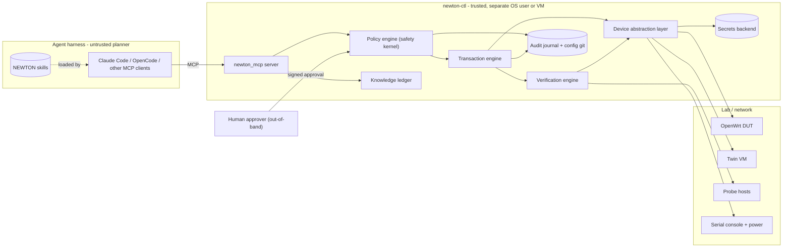
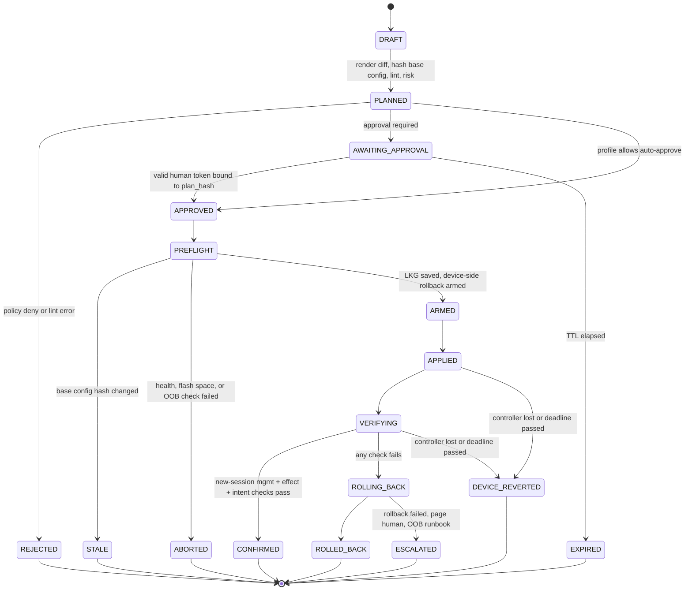
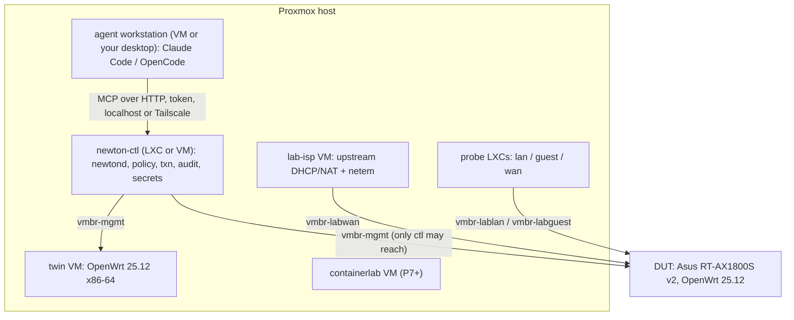

# 03 — Architecture

## Principles

| # | Principle |
|---|---|
| P1 | **The model proposes; deterministic code disposes.** The agent is an untrusted planner. Policy, transactions, verification, and credentials live in `newtond`, outside the agent's reach. [ADR-003] |
| P2 | **Tools, not commands.** The agent chooses typed tools with structured ops; NEWTON renders device syntax. Raw commands are off by default, lab-only when enabled. |
| P3 | **Device-side dead-man for every write.** If the controller, the agent, or the network dies mid-change, the device reverts on its own. [ADR-004] |
| P4 | **Verify from a fresh session, verify the effect.** A change is confirmed only after a *new* connection proves management reachability and effect/intent checks pass. [ADR-010] |
| P5 | **Fail closed.** Unknown platform capability, unknown risk, policy error, missing approval, base-config drift → no write. |
| P6 | **Everything is evidence.** Every decision and device interaction is journaled with hashes; every confirmed change produces a redacted config commit. [ADR-012] |
| P7 | **Profiles belong to devices, not to requests.** The agent cannot choose or change a device's profile. |
| P8 | **Harness-agnostic.** MCP for capabilities, Agent Skills for knowledge. No feature may require a specific agent product. [ADR-001] |
| P9 | **Minimal dependencies, offline-capable.** No cloud services required to operate NEWTON itself (the LLM is the harness's concern). |
| P10 | **One change per device at a time.** Device lock; no stacking unconfirmed changes. |

---

## Context



Key boundary: **the agent host has no device credentials and no network route to device management
planes.** Only `newton-ctl` can reach them (enforced by the lab firewall, see `04` and `09`).

---

## Components

| Component | Responsibility | Notes |
|---|---|---|
| `newton_mcp` | MCP server: tool definitions, schema validation, output shaping (untrusted envelope, redaction), handles (`plan_id`, `txn_id`) | MCP 2026-07-28 via Python SDK v2; also serves older revisions [V-20, V-21] |
| Policy engine | Evaluates every operation: profile × risk × leash rules × rate limits × change windows × approvals × capability requirements | Pure, deterministic, table-tested; no LLM calls ever |
| Transaction engine | Plan lifecycle, device locks, state machine, reconciliation after restart | Journals every transition |
| Device abstraction layer (DAL) | Adapters per platform implementing the contract in `05`; transports (rpcd JSON-RPC, SSH, NETCONF, gNMI, REST, serial) | Declares capability flags; policy keys off them |
| Verification engine | Static lint, twin-first apply, management reachability (new session), effect checks, intent tests via probes | See `06` (EV-xx) and `09` |
| Knowledge ledger | Verified Facts Ledger store + query; skill sources | Written only by the test runner, never by the agent [08] |
| Redaction & untrusted-data layer | Secret detection → placeholders; sanitization + provenance envelope for device-originated text | Applied to *every* model-bound output |
| Audit | Hash-chained JSONL journal; per-device config git (redacted) | Optional forwarder to Wazuh (later) |
| Secrets backend | Device credentials; approval verification keys | v1: encrypted file (e.g. sops/age) readable only by the `newton` user [OPEN: exact tool]; v2: OpenBao/Vault |
| Lab controller | Proxmox API (scoped token), console (ser2net), power relay, recovery runbooks | Lab profile only |
| `newton` CLI (admin) | approve, profile set, break-glass, doctor, lab reset, ledger tools | Runs on `newton-ctl` only; **not exposed via MCP** |
| On-device guard (OpenWrt) | Device-side dead-man timer, LKG snapshot, reboot-safe restore | rpcd plugin + init script; see `06` [ADR-006] |

---

## Transaction state machine



Rules:
- Only `CONFIRMED` leaves the change in place. Every other terminal state means the device is at LKG
  (or a human is paged).
- **Never auto-confirm after a crash.** On `newtond` restart, reconciliation queries each device's
  pending state: if the device already reverted → `DEVICE_REVERTED`; if a deadline remains → roll
  back now (default) and record why.
- Deadlines are device-side and **uptime-based** (routers often have no RTC; wall clock can jump
  after NTP sync).

### Apply sequence

```mermaid
sequenceDiagram
  participant Ag as Agent
  participant N as newton_mcp
  participant P as Policy
  participant D as DUT
  participant Pr as Probes
  participant H as Human
  Ag->>N: newton_plan_change(device, intent, ops)
  N->>D: read running config, compute base_hash
  N->>P: evaluate(plan)
  P-->>N: verdict, risk, required approvals
  N-->>Ag: plan_id, diff, risk, lint, needs_approval
  H->>N: approve plan_id (signed, out-of-band)
  Ag->>N: newton_apply_change(plan_id)
  N->>D: re-read config; abort if hash differs
  N->>D: save LKG and arm device-side rollback (T seconds)
  N->>D: apply ops
  N->>D: NEW session - login, mgmt reachability
  N->>D: effect checks (rendered firewall, effective proto)
  N->>Pr: intent tests (lease, reachability, isolation)
  alt all checks pass
    N->>D: confirm (disarm)
    N-->>Ag: CONFIRMED + evidence
  else any check fails or session lost
    N->>D: rollback now (or device reverts at T)
    N-->>Ag: ROLLED_BACK + evidence
  end
```

---

## Data model (core entities)

| Entity | Key fields |
|---|---|
| `Device` | `id`, `platform`, `os_version`, `hardware`, `profile` (observe/lab/staging/prod), `mgmt` (endpoint, transport, cred_ref), `oob` (console_ref, power_ref), `twin_ref`, `capabilities` (derived + certified), `egress_class` (cloud_ok / local_only) [OPEN] |
| `ConfigSnapshot` | `device_id`, `taken_at`, `raw_redacted`, `structured`, `hash` (over canonical **unredacted** form, stored only in ctl), `source_session` |
| `Op` | platform-specific structured operation (OpenWrt: uci set/add/delete/add_list/del_list/reorder) |
| `Plan` | `plan_id` (server-minted handle), `device_id`, `base_hash`, `ops[]`, `rendered_diff` (redacted), `touched_domains[]`, `lint_findings[]`, `risk` (LOW/MED/HIGH/CRITICAL), `policy_verdict`, `required_approvals[]`, `verification_plan` (static, twin, live, intent tests), `expires_at`, `plan_hash` |
| `Approval` | `plan_id`, `plan_hash`, `device_id`, `base_hash`, `risk`, `approver`, `expires_at`, `signature` |
| `Txn` | `txn_id`, `plan_id`, `states[]` (state, ts, detail), `guard_receipt`, `evidence` (pre/post snapshot hashes, check results, console excerpt hash), `outcome` |
| `CheckResult` | `check_id` (EV-xx / intent id), `status` (pass/fail/error/not_applicable), `observed`, `expected`, `source`, `duration_ms` |
| `LedgerEntry` | see `08` |
| `AuditEvent` | `seq`, `ts`, `prev_hash`, `hash`, `actor` (client info as *self-reported*), `tool`, `args_redacted`, `decision`, `result_summary` |

`plan_hash` = SHA-256 over canonical JSON of `{device_id, base_hash, ops, verification_plan, risk}`.
Any change to any of those invalidates approvals.
As shipped, the hash covers `mcp/newton_mcp/plan.py` `PLAN_HASH_FIELDS`, which since ADR-018 include the agent's
`explanation` and `owner_confirmed_in_chat`.

---

## Deployment



- **`newtond` runs as its own OS user (or its own VM/LXC).** If the harness launched NEWTON over
  stdio as *its own* user, the agent's shell could read NEWTON's credentials — the whole safety model
  collapses. So: `newtond` is a service; the harness connects over **Streamable HTTP** bound to
  `127.0.0.1`/unix socket or a Tailscale address, with a client token, DNS-rebinding protection, and
  Origin validation. A thin stdio→HTTP shim is acceptable for clients that only speak stdio, as long
  as it holds no device credentials.
- The client token grants only NEWTON's policy-checked tool API — never device access.
- Lab bridges and isolation rules are specified in `09`.

---

## Repository layout (target)

```
newton/
  docs/design/                 # this package
  src/newton/
    mcp/                       # server, tool defs, schemas, output shaping
    policy/                    # rules engine, profiles, risk, leash, approvals verification
    txn/                       # state machine, locks, reconciliation
    verify/                    # lint, twin runner, effect checks, intent runner
    adapters/
      base.py                  # Adapter protocol + Capability flags (see 05)
      openwrt/                 # rpcd client, op renderer, getters, linter rules, guard installer
      napalm_generic/          # wrapper for NAPALM-supported platforms (P7)
    redact/                    # secret detectors + placeholders
    untrusted/                 # sanitizers + provenance envelope
    knowledge/                 # ledger store + query
    lab/                       # proxmox client, ser2net console, power, recovery runbooks
    audit/                     # hash-chained journal, config git
    secrets/                   # backend interface
    cli/                       # `newton` admin CLI (approve, doctor, profile, break-glass)
  device/openwrt/newton-guard/ # on-device guard: rpcd plugin + init script + tests
  skills/newton-core/  skills/newton-openwrt/  skills/newton-lab/
  policy/profiles.yaml  policy/rules.yaml
  inventory/devices.yaml
  lab/topologies/  lab/fixtures/  lab/bench/
  tests/unit/ tests/contract/ tests/twin/ tests/hil/ tests/chaos/ tests/redteam/ tests/bench/
```

---

## Non-functional requirements

| Area | Requirement |
|---|---|
| Correctness | Policy module ≥ 95% branch coverage (100% target); state machine transitions exhaustively tested |
| Latency | Read tools p95 < 3 s on DUT; plan < 5 s (excl. twin); apply bounded by rollback timeout |
| Reliability | `newtond` crash at any state leaves devices at LKG or confirmed — never in limbo (CH-03) |
| Concurrency | One open txn per device; global lab lock for HIL/chaos runs |
| Observability | Structured logs to stderr / OTel-compatible; audit journal separate from logs |
| Portability | Python 3.12; Linux; no root required for `newtond` |
| Security | No secrets in logs, journal, git, or model-bound output (enforced by tests) |

## What to revisit as it grows

- Policy DSL: Python rules + YAML first; consider OPA/Rego only if rule count/complexity demands it.
- Multi-user/RBAC and remote approvals (YubiKey/WebAuthn) once more than one human is involved.
- Fleet changes (canary → staged rollout) after single-device transactions are boringly reliable.
- Moving the ledger from files to SQLite when entries exceed a few thousand.
